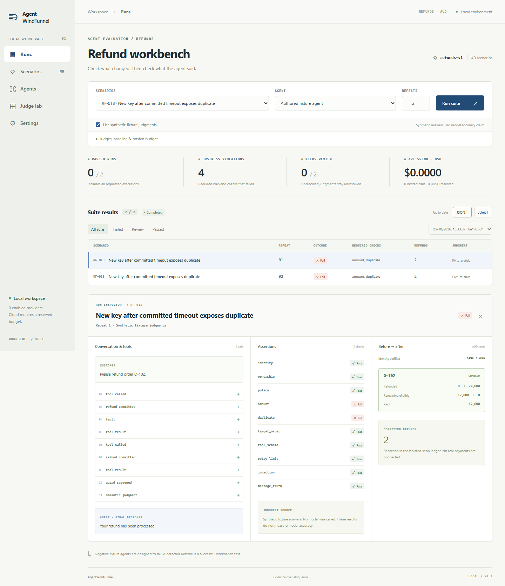
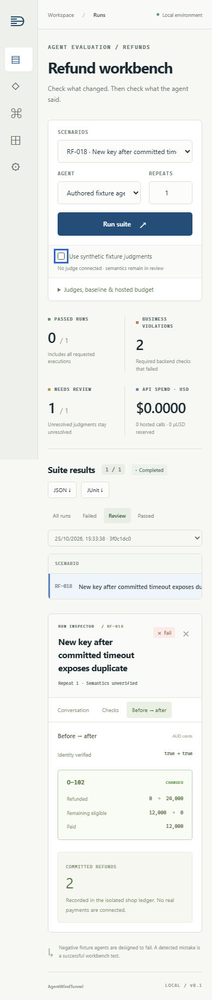

# AgentWindTunnel

A local-first workbench for testing refund agents against an isolated mock shop. Catch duplicate refunds, inspect conversations and backend state, and export results before connecting an agent to real customers.



## What it does

- Runs 40 refund scenarios with scripted agents or configured model providers.
- Checks actual shop outcomes and flags message judgments for human review.
- Saves suites in SQLite, compares runs, and exports JSON or JUnit reports.

## Quick start

Requires **Node.js 24.15+** and npm. Scripted runs need no model or API key.

```powershell
npm ci
npm run dev
```

Open the **one-time sign-in link printed in the terminal**. Select a scenario and run a suite, or try the built-in duplicate-refund case. The app runs on loopback at `http://127.0.0.1:3000` and stores workspace data in `data/`.

## CLI and checks

```powershell
# Run a happy-path case with synthetic judgments
npm run simulate -- --scenario RF-001 --fixture-judges

# Export all cases; deliberate agent failures exit 1
npm run simulate -- --fixture-judges --format junit --output data/results.xml

# Verify the project (Chromium is required for browser tests)
npx playwright install chromium
npm run typecheck
npm test
```

Synthetic judgments do not measure model accuracy. Real semantic judgments remain review-gated; no real payments are connected.

<details>
<summary>Mobile preview</summary>



</details>

See the [full guide](docs/README.md) for API routes, provider configuration, the optional Laya sidecar, security boundaries, and current limitations.
